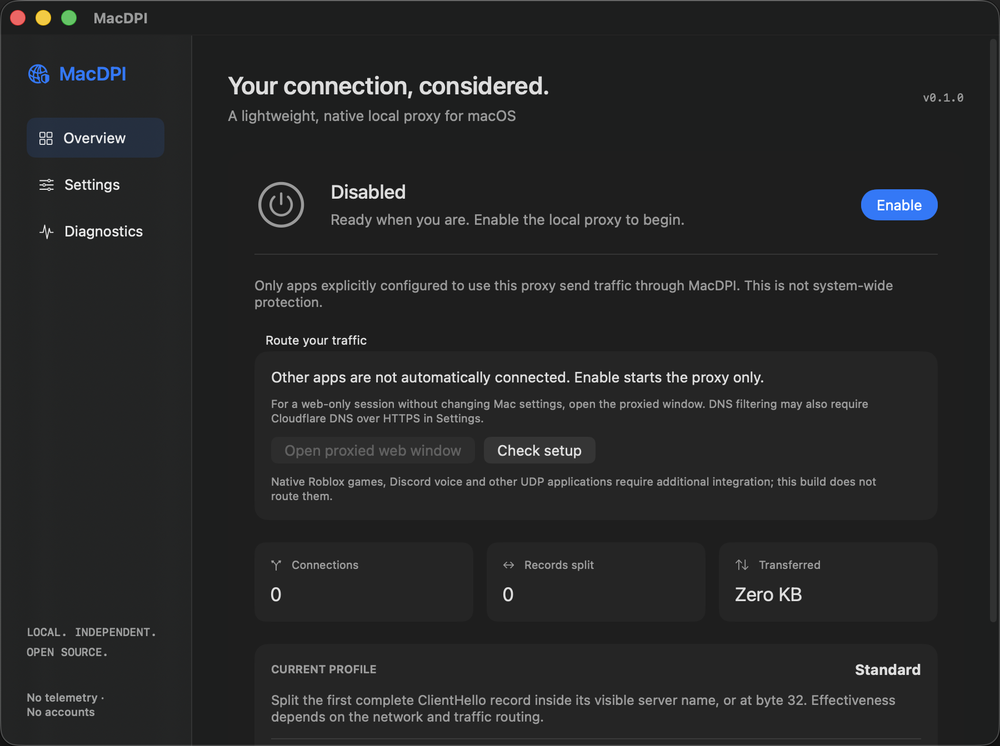

# MacDPI

A lightweight, independent, native macOS utility that forwards explicitly configured HTTPS connections and splits their initial TLS ClientHello into separate TLS records. SwiftUI interface, Network.framework engine, no third-party runtime dependencies.

**Pre-release 0.1.0.** TLS record splitting plus optional encrypted DNS passed a limited real-network check for Discord and Roblox on 2026-11-04, while unchanged TLS connections failed. [Exact evidence and limits](docs/REAL_NETWORK_VALIDATION.md). This does **not** establish native Roblox gameplay, Discord voice, every site, or every network. This is a local HTTPS proxy, not a VPN or automatic system-wide protection. It does not decrypt TLS or install certificates.



[Light appearance](docs/dashboard-light.png) · [Diagnostics](docs/diagnostics.png)

## What works

- HTTP CONNECT on `127.0.0.1:8080`, with public TCP port 443 destinations by default.
- Standard profile: split a complete first ClientHello record inside the visible SNI, or at payload offset 32 when SNI is absent.
- Advanced profile: choose the record split offset. Compatibility profile: forward unchanged.
- Optional Cloudflare DNS over HTTPS for proxy connections, with certificate validation, bounded cancellation and a TTL-limited RAM cache. System DNS remains the default; macOS DNS settings are never changed.
- Optional isolated HTTPS web window on macOS 14+, routed through MacDPI without changing other apps' network settings.
- Bounded streaming, backpressure, concurrency limits, connection deadlines, half-close and explicit shutdown.
- Native dashboard, menu bar control, settings, sanitized diagnostics, light/dark appearance and keyboard access.
- Opt-in launch at login on macOS 13+. The engine always starts disabled in normal use.
- Universal 2 app and separate experimental transparent provider compilation.
- Loopback tests, benchmarks, CI and local ZIP/DMG packaging.

The transparent provider is **not bundled, installed, activated or integration-tested**. It requires Apple entitlements, provisioning, Developer ID signing and explicit permission. Native games/UDP voice, automatic profile selection, DoT, QUIC manipulation, packet fragmentation and guaranteed TCP segmentation are not implemented.

## Build and run

On a Mac with full Xcode and Swift 5.9+:

```sh
scripts/build-app.sh
open build/release/MacDPI.app
```

The original IDE project is `MacDPI.xcodeproj` (Xcode 27.2 project format). The build script avoids dependence on that newer project format; older Xcode compatibility is not runtime-verified. App deployment target: macOS 12.0. Both Intel and Apple Silicon compile; runtime verification currently covers Apple Silicon/macOS 26.6 only.

**Enable starts a listener; it does not route Discord, Roblox or the rest of your Mac automatically.** For a web-only session on macOS 14+, choose Standard and (if DNS filtering is present) Cloudflare DNS over HTTPS in Settings, enable, then select **Open proxied web window**. This window uses session-only website data and disables microphone/camera; native game links are unsupported.

For another proxy-capable application, explicitly configure its HTTP CONNECT proxy. Record its previous setting. A per-command example:

```sh
curl --proxy http://127.0.0.1:8080 --http1.1 https://example.com/
```

This command makes an ordinary connection to the named site; it is not a DPI effectiveness test. No script changes system proxies, DNS, routes, firewall, VPNs or trust settings. Applications that ignore the proxy remain outside its scope. Disable the engine to close all of its connections and listener.

## Development and evidence

```sh
swift test --scratch-path build/swift
swift build --scratch-path build/swift -c release
xcrun swiftc -swift-version 5 Tools/TLSFixture/main.swift -o build/tls-fixture
python3 scripts/integration.py
```

The TLS 1.3 fixture requires macOS 15+ for memory-only identity loading; the production app still targets macOS 12. Nothing is added to the keychain. Test certificates and keys are ephemeral, confined to ignored `build/` directories, and never trusted system-wide.

Read [final engineering report](docs/FINAL_REPORT.md), [actual test results](TEST_RESULTS.md), [compatibility](COMPATIBILITY.md), [performance](PERFORMANCE.md), [architecture](ARCHITECTURE.md), [building](BUILDING.md), [installation and recovery](INSTALLATION.md), [privacy](PRIVACY.md), [security](SECURITY.md), and [release notes](docs/RELEASE_NOTES.md).

MIT licensed. No telemetry, accounts, advertising, analytics, external relays or browsing history storage. Networking metadata necessarily exists transiently in memory and in the system resolver. Circumvention depends on the network and DPI implementation; splitting records alone may have no effect.
